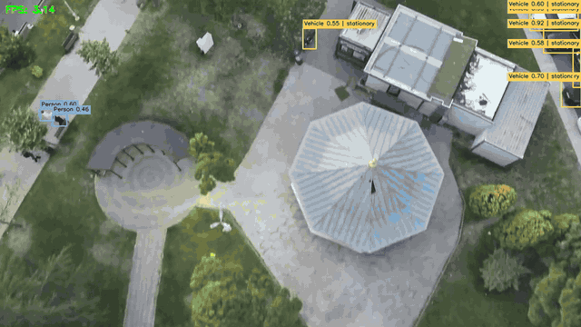

# Aerial Detection Pipeline

Find vehicles, people, and marked landing areas in aerial images or videos, then view the results in your browser.



[](https://huggingface.co/Has1tas/yolo26s-aerial-uav)
[Source code](https://github.com/hasbitas/aerial-detection-pipeline) | [Model card](hf/README.md) | [License](LICENSE)

## What does it do?

Give it a short video or a set of images taken in sequence from a drone camera.
It draws boxes around vehicles, people, and two kinds of marked areas used in the TEKNOFEST competition.
It estimates whether vehicles are moving and whether a detected landing area looks clear in the image.
For example: aerial video -> video with labels + a table you can download.
It is a portfolio project for TEKNOFEST 2026 Aviation AI, task 1; its labels do not prove that a real landing is safe.

## Demo preview

<!-- DEMO_VIDEO -->

Screenshot/GIF slot: add demo images or recordings to [docs/](docs/), then link them here.
No preview is included yet.

## Quick start (5 minutes)

Allow extra time for package downloads on a slow connection. No coding knowledge is needed.

1. Install **Python 3.11 or newer** from [python.org](https://www.python.org/downloads/).
   On Windows, tick **Add Python to PATH** in the installer. Close and reopen any terminal afterward.
   Python 3.12 is the version used to verify this project. This project has no separate frontend; Node.js is not needed.
2. [Open the project on GitHub](https://github.com/hasbitas/aerial-detection-pipeline).
   Click the green **Code** button -> **Download ZIP**. Extract the ZIP into a normal folder first.
   Alternatively, if you already have Git, run:
   ```text
   git clone https://github.com/hasbitas/aerial-detection-pipeline.git
   cd aerial-detection-pipeline
   ```
3. Open the extracted project folder.
   **Windows:** double-click `setup.bat`, wait for "Setup complete", then double-click `start.bat`.
   **macOS/Linux:** open Terminal in that folder and run:
   ```sh
   chmod +x setup.sh start.sh
   ./setup.sh
   ./start.sh
   ```
   Setup creates `.venv`, a private folder for this project's Python packages (extra tools it needs), and installs both requirements files.
4. Your browser should open **http://127.0.0.1:7860** with video and image upload boxes and an **Analyze** button.
   For a one-click run, **click the sample video example** below the outputs; analysis starts automatically.
   If it does not open, paste that address into your browser. Keep the terminal window open.
   Stop the demo with **Ctrl+C** in that window; on Windows you can also close the window.

## Try the demo

After setup, start it from the project folder with these exact commands:

**Windows (Command Prompt or PowerShell):**

```powershell
.\start.bat
```

**macOS/Linux:**

```sh
./start.sh
```

1. Open http://127.0.0.1:7860 and **click the sample video example** to load the bundled clip and start analysis.
   Alternatively, choose **either** one short video **or** consecutive images, then click **Analyze**.
2. The first analysis automatically downloads the model weights (saved information learned during training),
   about **20.5 MB**, from [Hugging Face](https://huggingface.co/Has1tas/yolo26s-aerial-uav), unless `models/yolo26s-aerial.pt` already exists.
   Internet is needed for setup and that first download. Later analysis can use the local weights without internet.
3. Look at **Annotated frames** or **Annotated video**, then click **Download detection CSV** to save the results table.
   A CSV is a plain-text table that spreadsheet apps can open. Download results before stopping the server; demo files are temporary.

Videos may contain up to **600 frames** (20 seconds at 30 frames per second).
Image requests may contain up to **100 images**, ordered by filename (`frame2.jpg` comes before `frame10.jpg`).
Output videos have no audio. Processing on the CPU (your computer's main processor) at the default image size can take a while.

### Sample data

The example clip contains frames 1200-1499 of the **TEKNOFEST 2025 Aviation AI
(Havacilikta Yapay Zeka), session-1 sample sequence**: `frame_001200.webp` through
`frame_001499.webp` (300 frames). Credit: [TEKNOFEST](https://www.teknofest.org/).
The sample shows vehicles and people; it contains no UAP/UAI landing areas.
It is downscaled from 3840×2160 to 1280×720, encoded as H.264 at 30 fps (10 seconds),
and included only for demonstration. The GIF shows six seconds of real pipeline output;
[the screenshot](docs/screenshot.png) shows a frame with several detections.

Regenerate the clip from your own local copy of that sequence (requires ffmpeg on PATH
or `imageio-ffmpeg` from the demo requirements):

```sh
python examples/make_sample.py path/to/source_frames --start 1200 --count 300 --output examples/sample_300_frames.mp4
```

With local weights installed, `python examples/render_demo.py` regenerates the GIF and
screenshot on CPU. Per-frame detections and timing observations go to ignored
`outputs/sample_demo/`; they are demonstration results, not accuracy measurements.

To locate landing-area detections across a full image sequence without changing
the sample clip, run a CPU scan (every tenth source frame, 100-frame windows):

```sh
python examples/scan_sequence.py path/to/source_frames --output outputs/sequence_scan.json
```

Counts are detection boxes summed over sampled frames, not unique objects or
estimates for skipped frames. Windows use zero-based positions in natural filename
order. The JSON includes sampled filenames, confidence, and inference image size.

## How it works

YOLO26s, a trained object detector, finds boxes around objects in each frame (one image from a video).
The pipeline, a series of processing steps, gives the classes (object categories) consistent names.
Optical flow, the movement of visible image details between frames, helps separate camera movement from vehicle movement.
Landing rules check whether a marked area is cut off at the edge or overlaps a detected obstacle.
The optional preview shows the labels; the CSV stores them as numbers.

```text
Frame sequence -> natural ordering + decode prefetch -> YOLO detections
    -> canonical class mapping -> optical-flow motion + landing rules
    -> detection CSV + optional timing CSV / annotated preview
```

Here, natural ordering means sorting numbered filenames as people expect. Decode prefetch means preparing the next images ahead of time.
Canonical class mapping means converting the model's labels to the fixed output categories below.
A timing CSV records how long processing took.

**UAP** is the TEKNOFEST flying-car parking area. **UAI** is the TEKNOFEST flying-ambulance landing area.
These are competition markings, not general-purpose recognition of every possible parking or landing site.

| ID | Output class | Meaning | motion_status | landing_status |
|---|---|---|---|---|
| 0 | Vehicle | Vehicle | 0 or 1 | -1 |
| 1 | Person | Person / obstacle | -1 | -1 |
| 2 | UAP | Flying-car parking area | -1 | 0 or 1 |
| 3 | UAI | Flying-ambulance landing area | -1 | 0 or 1 |

| Code | Motion | Landing |
|---|---|---|
| -1 | Not applicable | Not applicable |
| 0 | Stationary | Unsuitable |
| 1 | Moving | Suitable |

For a Person, neither status applies, so both codes are -1. A single photo cannot establish motion; new or unmatched vehicles start as stationary. "Suitable" means the area passes the image rules, not that a real landing is safe.

## Folder guide

| Folder/file | Purpose |
|---|---|
| `setup.bat` / `setup.sh` | Install the Python packages for your operating system. |
| `start.bat` / `start.sh` | Open the local browser demo. |
| `demo/` | Browser interface and its extra package list. |
| `examples/` | Bundled sample video and scripts to regenerate the sample and visuals. |
| `docs/` | Annotated demo GIF and representative screenshot. |
| `models/` | Local model weights; created on download if needed and ignored by Git. |
| `outputs/` | Default command-line results; created when needed and ignored by Git. |
| `.gradio/` | Temporary browser-demo results; created when needed and ignored by Git. |
| `run_pipeline.py` | Command-line processing for a folder of frames. |
| `run.bat` | Optional Windows shortcut for the frame command line; use `start.bat` for the demo. |
| `model_weights.py` | Download helper and shared model location. |
| `status_resolver/` | Motion estimates, landing rules, and their settings. |
| `hf/` | Model card, stored training information, and inspection tool. |
| `tests/` | Checks that the processing rules and output formats still work. |
| `requirements.txt` | Main Python package list. |
| `LICENSE` | Terms for using and sharing this project. |

## Troubleshooting

| Problem | What to do |
|---|---|
| "Python not found", or the Microsoft Store opens | Install Python 3.11+ from python.org with **Add Python to PATH** selected. Reopen the terminal and run setup again. On macOS/Linux, the scripts look for `python3`, then `python`. |
| Setup or `pip install` fails | Read the last error above "Setup failed". Check your internet connection, free disk space, and Python version. Run setup again. On Linux, a missing `venv` module may require your distribution's `python3-venv` package. For `libGL.so.1` errors, see the Linux packages below. |
| "Port already in use" or port 7860 is unavailable | Stop a previous demo with Ctrl+C or close its terminal, then rerun start. Keep port 7860 free; the start scripts request that exact port. |
| Model download is slow or internet is unavailable | Wait for the first ~20.5 MB download and check access to Hugging Face. Retry Analyze after reconnecting. For offline use, copy the trusted `yolo26s-aerial.pt` file to `models/` first (create the folder if needed). |
| "CUDA not available", or processing is slow | CUDA lets supported NVIDIA graphics cards run the detector. The start scripts use CPU, which is fine and needs no CUDA. Remove a manual `--device cuda` option, and try a photo or shorter video. |
| Scripts will not run, or the page does not open | Extract the ZIP first and run setup before start. On macOS/Linux run `chmod +x setup.sh start.sh`, or use `bash setup.sh` and `bash start.sh`. Open http://127.0.0.1:7860 manually after the server prints its address. |

## For developers

Run commands below from the repository root. Activate the environment first so `python` uses the installed packages:

**Windows PowerShell:**

```powershell
.venv\Scripts\Activate.ps1
```

**macOS/Linux:**

```sh
source .venv/bin/activate
```

If PowerShell blocks activation, use `.venv\Scripts\python.exe` in place of `python`; activation is optional.
The setup scripts require Python 3.11+ for this beginner path; the existing core requirements declare Python 3.10+.

### Manual installation and launch

```text
python -m venv .venv
```

Activate it as shown above, then:

```text
python -m pip install --upgrade pip
python -m pip install -r requirements.txt -r demo/requirements.txt
python demo/app.py --device cpu --open-browser
```

The start scripts also set `GRADIO_SERVER_NAME=127.0.0.1` and `GRADIO_SERVER_PORT=7860` so the demo stays local and uses the documented port.
Manual launches use Gradio's (the browser interface package's) environment settings and port selection. Omit `--open-browser` to print the address without opening a browser.
`setup.bat --check` checks Windows prerequisites without installing anything.

CUDA is optional. For CPU-only PyTorch packages, install `torch` and `torchvision` from the [official CPU wheel index](https://pytorch.org/get-started/locally/) before installing requirements. For GPU inference, install the appropriate CUDA builds and use `--device cuda`. The frame CLI defaults to `--device auto`: CUDA when available, otherwise CPU. The demo defaults to CPU.


### Frame command line and checkpoint

The public weights are available at [Has1tas/yolo26s-aerial-uav](https://huggingface.co/Has1tas/yolo26s-aerial-uav) as `yolo26s-aerial.pt`. The download helper uses this live repository.

Replace `path/to/frames` (or `path\to\frames`) with your own folder of consecutive images. These are placeholders, not bundled sample paths.

```bash
# Download the public checkpoint:
python model_weights.py

# Or place the trusted checkpoint at models/yolo26s-aerial.pt manually.
python run_pipeline.py --frames path/to/frames --device cpu --no-display --csv outputs/detections.csv
python run_pipeline.py --help
```

Inference explicitly uses `--imgsz 1280` by default to match the training image size, with `--conf 0.25`. Files are naturally sorted (`frame2.jpg` before `frame10.jpg`). Unreadable frames produce a warning and are skipped; processing continues with the next frame. Use `--no-profile` to disable timing output or omit `--no-display` for the OpenCV preview; press `q` to stop. On Windows, `run.bat --frames path\to\frames --no-display` forwards the same arguments and prefers the local virtual environment.

**Checkpoint:** the network has three detection scales with strides `[8, 16, 32]` and no stride-4 P2 head. The stored run name `s_p2_1280_A` is a legacy label. The checkpoint records 120 requested epochs, zero-based epoch 42, 43 history entries, batch 4, and image size 1280. Stored validation mAP50 is 0.89934 and mAP50-95 is 0.71862; these are not new evaluations. See [the model card](hf/README.md) and [checkpoint metadata](hf/checkpoint_info.json).

### Status rules and configuration

Checkpoint class order is normalized by name, including legacy labels; the output order above is fixed. Optional person motion is available as an internal debug value. CSV status codes remain unchanged. Shared CLI, demo, and documentation annotations show class and confidence, with `moving`/`stationary` only for Vehicle and `landing OK`/`landing blocked` only for UAP/UAI. Each class has a distinct box color and a filled label background.

**Motion:** sparse Lucas-Kanade optical flow follows background features on downscaled frames. A RANSAC partial affine transform estimates camera motion relative to three frames earlier. Same-class detections are matched exclusively using flow-predicted centers. Residual center displacement after camera compensation must exceed both 5% of the box diagonal and an adaptive pixel floor (at least 3 pixels). A five-observation majority vote reduces jitter; young tracks default to stationary. Edge-clipped boxes suppress raw motion estimates. Thresholds are configurable in `status_resolver/config.py`.

**Landing:** a UAP/UAI box within 15 pixels of the image boundary is considered clipped and unsuitable. An overlapping Vehicle or Person blocks landing when `intersection / min(area_pad, area_obstacle) > 0.3`. Otherwise the detected area is marked suitable. This is an image-space heuristic, not a physical landing-safety assessment.

### Hosting reference

To host as a **Hugging Face Gradio Space**, keep the whole repository tree, install both requirements files (append `-r demo/requirements.txt` to the Space's root `requirements.txt`), and add this YAML to the top of the Space's root README:

```yaml
---
title: Aerial Detection Pipeline
sdk: gradio
sdk_version: 5.49.1
python_version: "3.12"
app_file: demo/app.py
license: agpl-3.0
---
```

`hf/README.md` is the **model** card, not the Space README. The app imports correctly from either the repository root or `demo/`, and building its interface does not download weights. On Linux, OpenCV may require system packages `libgl1` and `libglib2.0-0` (list them in the Space's `packages.txt` if needed). Keep the working directory writable for `.gradio/` outputs. Demo runs are serialized; source artifacts are removed at server shutdown and Gradio expires served cache copies periodically.

### Output files and Python API

The browser demo uses `analyze(video, images, device="cpu")` in `demo/app.py`, returning a video path (or `None`), a gallery, and a CSV path. The frame CLI shares `process_frame` and the status resolver. There is no separate competition-server client or stable public web API contract.

Default files: `outputs/yolo26s-aerial.csv` and `outputs/yolo26s-aerial_profile.csv`.

```text
frame_id,class_id,class_name,x1,y1,x2,y2,motion_status,landing_status,fps
```

There is one row per detection. A frame without detections produces one row with blank detection/status fields. Box coordinates are integer pixel positions in the original image. `fps` measures YOLO plus status resolution for that frame; it excludes image decoding, annotation, file writes, and browser rendering. The optional profile CSV separates inference and resolver stages. Confidence is used for filtering and shown in annotations; it is not a CSV column. No persistent tracking IDs are exported.

The profile CSV retains the following schema. All timing columns are milliseconds:

| Column | Meaning |
|---|---|
| `frame_id` | Source frame filename |
| `num_detections` | Number of detections after filtering |
| `yolo_ms` | Detector inference time |
| `resolver_ms` | Total status resolver time, including the stages below |
| `extract_ms` | Box extraction and conversion to CPU arrays |
| `egomotion_ms` | Camera-motion estimation and motion resolution |
| `landing_ms` | Landing visibility and obstacle rules |
| `assemble_ms` | Output detection assembly |
| `fps` | Same YOLO-plus-resolver rate as the detection CSV, in frames/second |

Resolver stage timings are components of `resolver_ms`, not additional time to add to it. Unreadable frames have no detection or profile rows.

### Tests and metadata inspection

```bash
python -m pytest -q
python hf/inspect_checkpoint.py
```

Tests cover landing rules, exclusive matching, temporal voting, empty-frame history, class normalization, and output contracts. Demo tests require the demo extras. Metadata inspection uses `torch.load(..., weights_only=False)`; only inspect trusted checkpoints, since that format can execute pickle code.

## Glossary

- **UAV:** an unmanned aerial vehicle, such as a drone.
- **Frame:** one still image in a video or image sequence.
- **Object detection:** finding objects and drawing boxes around them.
- **YOLO26s:** the detector used here; `s` names its small model size.
- **Weights / checkpoint:** the saved file containing what a model learned and, here, training information.
- **Inference:** using a trained model to make predictions on new images.
- **Optical flow:** estimated movement of image details between frames.
- **CSV:** a plain-text table that spreadsheet apps can open.
- **Gradio:** the Python package that provides the browser interface.
- **CUDA / CPU:** NVIDIA's GPU computing system / your computer's main processor; CPU is the default for the demo.

## Limitations

- Aggregate validation scores do not establish generalization; current per-class scores are not available in the inspected metadata.
- Earlier experiments on a previous dataset version (validation: 225 images, 361 instances) showed weak Person detection: YOLO12s Person P=1.00, R=0.02, mAP50=0.04; YOLO11s Person R=0.04, mAP50=0.07. These are owner-reported historical results, not scores for this YOLO26s checkpoint. Evaluate Person detection on your own footage before use.
- UAP/UAI are competition-specific classes. Domain shifts, tiny objects, low light, thermal footage, and unseen viewpoints can degrade detection.
- Motion assumes a chronological, reasonably consistent frame sequence. Cuts, irregular frame rates, parallax, low texture, and camera-motion estimation failures can produce wrong states. Warm-up and unmatched detections default to stationary.
- Landing suitability depends on detected boxes and visible obstacles. It cannot establish depth, surface condition, or real-world safety. This is not an autonomous navigation or certified safety system.
- Neither the training dataset nor an end-to-end training recipe is distributed.

## License and acknowledgements

[AGPL-3.0](LICENSE). Detector inference is built on [Ultralytics](https://github.com/ultralytics/ultralytics). Thanks to [TEKNOFEST](https://www.teknofest.org/) for the Aviation AI competition context. This is an independent portfolio project maintained by [hasbitas](https://github.com/hasbitas); no official endorsement is implied.
